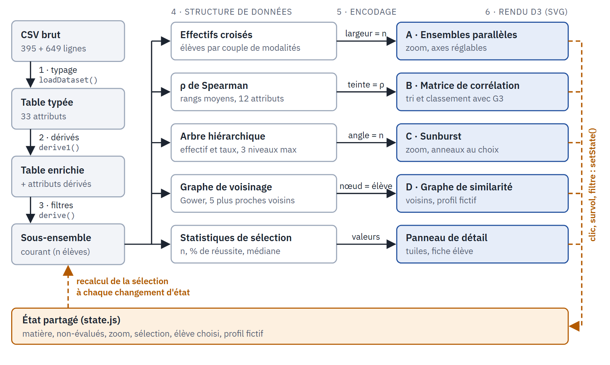
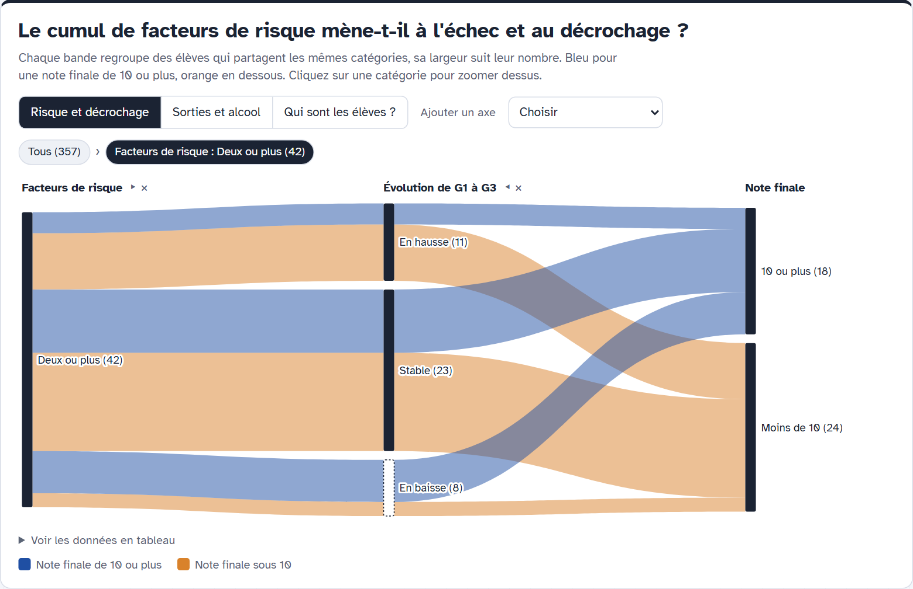
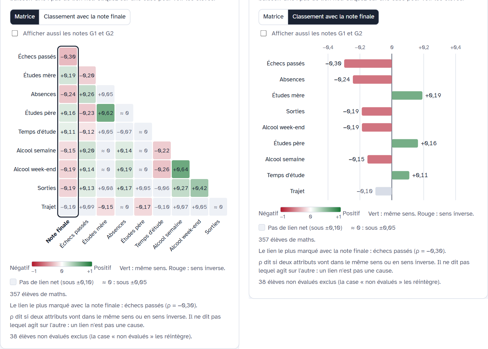
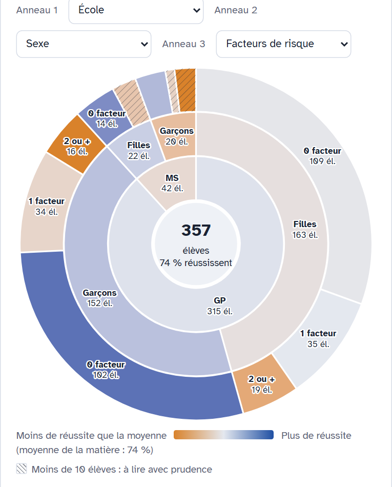
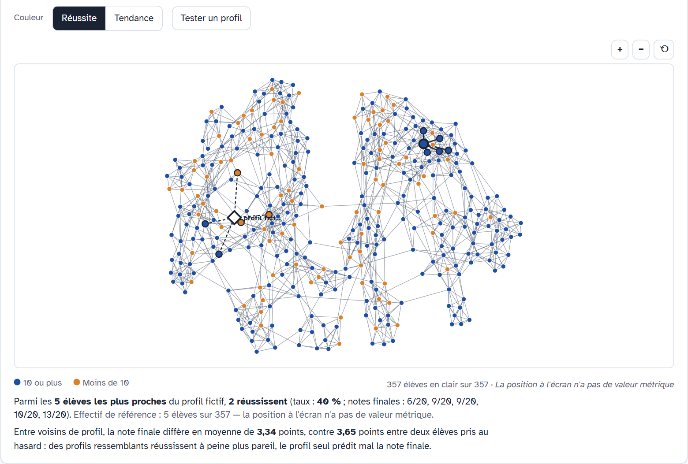
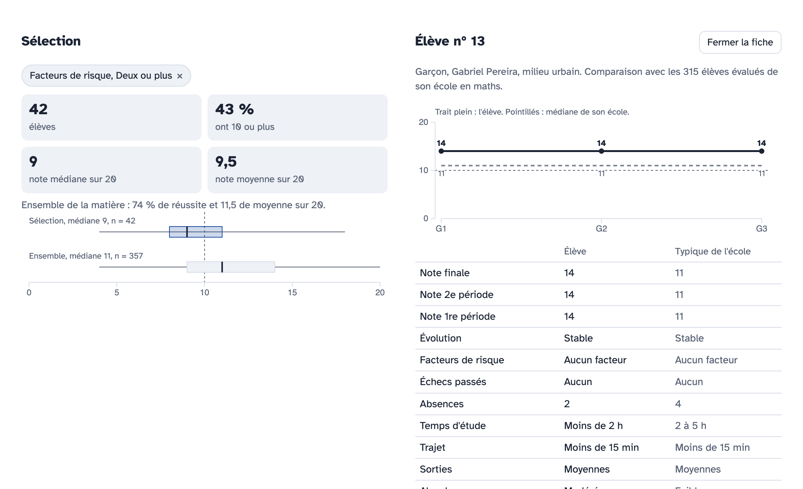

<div style="text-align:center" markdown="1">

&nbsp;

Projet de visualisation d'information

&nbsp;

# « Qu'est-ce qui accompagne la réussite au lycée ? »

DrunkAndStudy, un explorateur interactif de la performance scolaire, développé avec D3.js

&nbsp;

Présenté par

Quentin ELLEON · Jim LAINEL · Alexandre LARGUECH · Gabriel LOIRAT

&nbsp;

Sous la supervision de

Marco Winckler

&nbsp;

Polytech Nice Sophia, SI5 (parcours IHM/IA)

Cours de visualisation d'information

Année universitaire 2026-2027

&nbsp;

Novembre 2026

</div>

<div style="page-break-after: always;"></div>

## Résumé

Ce projet est une application web de visualisation interactive, écrite en D3.js, qui sert à explorer les facteurs associés à la réussite scolaire de lycéens portugais. Le jeu de données (*Student Alcohol Consumption*, sur Kaggle, tiré de Cortez et Silva, 2008) décrit 395 élèves en mathématiques et 649 en portugais par 33 attributs, dont 17 nominaux. Une visualisation qui ne s'appuierait que sur des axes numériques en laisserait donc de côté la moitié.

Deux publics sont visés. L'équipe pédagogique doit repérer les profils à risque, et les parents ou élèves veulent comprendre ce qui accompagne la réussite. Dix tâches ont guidé le choix de quatre techniques, une par membre du groupe, à savoir les ensembles parallèles, la matrice de corrélation de Spearman, le sunburst et le graphe de similarité (distance de Gower). Une sélection partagée relie ces vues à un niveau de détail, et l'utilisateur peut changer de matière ou importer son propre fichier CSV.

L'audit a montré que 53 élèves ont une note finale de 0 et aucune absence. Ce sont des dossiers non renseignés, codés 0. Les inclure inverse le signe de la corrélation entre absences et note finale en mathématiques (+0,02 avec eux, −0,24 sans eux). L'application les exclut donc par défaut, en affichant leur nombre, avec une case pour les réintégrer. Elle présente des associations, jamais des causes.

<div style="page-break-after: always;"></div>

## Table des matières

1. Introduction
2. Objectifs de l'étude, ou pourquoi présenter ces données
3. Problématique
4. Méthodologie, ou comment présenter les données
5. Analyse et interprétation des quatre visualisations
6. Discussion et résultats

Références · Annexe A (démonstration et contributions)

## Liste des illustrations

- Figure 1. Pipeline de visualisation
- Figure 2. Visualisation A, ensembles parallèles, zoomée sur les élèves à risque 2 et plus
- Figure 3. Visualisation B, matrice de Spearman et classement avec la note finale
- Figure 4. Visualisation C, sunburst
- Figure 5. Visualisation D, graphe de similarité avec un profil fictif
- Figure 6. Niveau de détail, panneau de sélection et fiche élève

<div style="page-break-after: always;"></div>

## 1. Introduction

La réussite scolaire dépend de nombreux facteurs, comme la famille, le mode de vie, le parcours antérieur ou l'assiduité. Un tableau de 33 colonnes et 1 044 lignes ne montre rien à l'œil nu, et un résumé statistique peut tromper. Le quartet d'Anscombe (1973) rappelle que des jeux de données de mêmes moyennes et de même corrélation peuvent avoir des structures très différentes, il faut donc regarder les données. Comme dans le cas de John Snow, une visualisation ne vaut que par la tâche qu'elle soutient pour un utilisateur donné.

DrunkAndStudy est une page web unique qui réunit quatre vues d'ensemble liées entre elles et un niveau de détail. Les données sont observationnelles, issues de deux lycées et en partie auto-déclarées, et l'application se limite à ce qu'elles permettent de dire.

Le cadre what-why-how de Munzner (2014) sépare les données, les tâches et l'encodage avec l'interaction. Il sert de fil à ce rapport, avec sa typologie des attributs (nominal, ordinal, quantitatif). Le pipeline suit le modèle de Card, Mackinlay et Shneiderman (1999), et l'interaction s'appuie sur le mantra de Shneiderman (1996), « vue d'ensemble d'abord, zoom et filtre, puis détails à la demande », ainsi que sur les golfes d'exécution et d'évaluation de Norman (1986). Les techniques viennent de Kosara, Bendix et Hauser (2006) pour les ensembles parallèles, de Stasko et Zhang (2000) pour le sunburst, de Friendly (2002) et Spearman (1904) pour la matrice de corrélation, et de Gower (1971) pour la similarité entre attributs de natures mélangées. L'outil est D3.js (Bostock, Ogievetsky et Heer, 2011).

## 2. Objectifs de l'étude, ou pourquoi présenter ces données

Deux profils d'utilisateurs sont visés. U1, l'équipe pédagogique (enseignants, CPE, direction), connaît bien le domaine et lit assez bien une visualisation. Elle doit repérer les profils à risque et décider où placer le soutien, sur des élèves identifiables. U2 regroupe les parents et les élèves, qui connaissent peu le domaine et lisent peu les visualisations. Ils veulent comprendre ce qui accompagne la réussite pour la favoriser, avec des vues simples, des mots courants et aucune comparaison nominative. Ces profils imposent de réduire le golfe d'exécution (aucun langage de requête, tout se fait au clic) et le golfe d'évaluation (l'effectif *n* à côté de chaque chiffre, des phrases simples dans les info-bulles).

L'objectif principal est de découvrir ce qui est associé à la réussite, pour décider (U1) ou prévenir (U2). Il se décline en dix tâches, listées ci-dessous. Les chiffres du rapport portent sur les élèves évalués, soit 357 en mathématiques et 634 en portugais.

| ID | Tâche | Public | Vue |
|---|---|---|---|
| U1-1 | Quels facteurs sont le plus associés à une note finale (G3) basse ? | U1 | B |
| U1-2 | Comparer G3 entre sous-groupes (école, sexe, milieu) | U1 | C, tuiles |
| U1-3 | Isoler les élèves qui cumulent des facteurs de risque | U1 | A |
| U1-4 | Consulter un élève et le situer par rapport à son école | U1 | D, fiche |
| U1-5 | Détecter un décrochage entre G1 et G3 | U1 | A, D |
| U2-1 | Voir comment les notes se répartissent | U2 (U1) | C, tuiles |
| U2-2 | Situer un profil fictif parmi des élèves semblables | U2 | D |
| U2-3 | Comprendre le lien entre sorties, alcool et notes, sans jargon | U2 (U1) | A |
| U2-4 | Comparer un profil à risque et un profil protégé | U2 (U1) | A |
| U2-5 | Faire varier un facteur et voir la note moyenne | U2 | Panneau de sélection |

## 3. Problématique

Comment représenter un jeu de données multivarié, de natures mélangées, pour que deux publics différents y trouvent des réponses justes à leurs questions, sans que la représentation en dise plus que les données ?

Quatre difficultés s'y rattachent. Le jeu compte 17 attributs nominaux, 10 ordinaux et 6 quantitatifs, et aucune technique ne les traite tous bien. Un codage ambigu (les notes à 0) change une conclusion statistique, et il faut le détecter puis le rendre visible. Un spécialiste veut des élèves identifiables, tandis qu'un parent veut une vue simple et non nominative. Enfin, les petits groupes, les données auto-déclarées et l'absence de causalité doivent apparaître dans l'interface elle-même.

## 4. Méthodologie, ou comment présenter les données

### 4.1 Le jeu de données et son audit

Le jeu *Student Performance* (sur Kaggle sous `uciml/student-alcohol-consumption`, miroir du jeu UCI n° 320, licence CC BY 4.0) regroupe des bulletins et un questionnaire de deux lycées portugais pour l'année 2005-2006. Il se compose de deux fichiers de 33 colonnes identiques, `student-mat.csv` (395 lignes) et `student-por.csv` (649 lignes), sans valeur manquante déclarée. Nous avons retenu ce jeu sur Kaggle parce qu'il est multivarié, comme le demande le sujet, et qu'il mêle des attributs nominaux, ordinaux et quantitatifs. C'est une table au sens de Munzner, où un item est un élève dans une matière.

Ses 33 attributs sont 17 nominaux (école, sexe, milieu, métiers des parents, etc.), 10 ordinaux (études des parents, temps d'étude, sorties, alcool, etc., sur des échelles de 1 à 5, stockées en entiers) et 6 quantitatifs (âge, échecs, absences, G1, G2, G3). Les nominaux se représentent par une teinte ou un regroupement, les ordinaux par leurs libellés plutôt que leurs codes, et les notes sur un axe fixe de 0 à 20. Nous avons écarté la famille « Location », car le seul attribut proche d'une position est le milieu (urbain ou rural), un binaire, et une carte à deux polygones n'encoderait pas plus qu'un diagramme à deux barres.

L'audit a révélé un problème de codage. 53 élèves (38 en mathématiques, 15 en portugais) ont `G3 = 0`, et tous ont aussi `absences = 0`. Un élève qui aurait réellement obtenu 0 après une année complète n'aurait pas une assiduité parfaite. Ce sont donc des dossiers non renseignés (abandon, absence à l'épreuve), codés 0. Le tableau ci-dessous mesure l'effet de ce codage.

| Corrélation de Spearman entre absences et G3 | Avec eux | Sans eux |
|---|---|---|
| Mathématiques | +0,02 | −0,24 |
| Portugais | −0,16 | −0,21 |

Mêmes données, deux conclusions opposées. Ces élèves « non évalués » sont donc exclus par défaut, avec leur nombre affiché, et une case permet de les réintégrer. Les supprimer en silence serait aussi trompeur que les garder en silence. Le jeu a d'autres limites. L'échantillon est de convenance (deux lycées, une année), plusieurs attributs sont auto-déclarés (69,9 % des élèves de mathématiques déclarent le minimum d'alcool en semaine), les données sont observationnelles et les strates sont déséquilibrées (l'école MS pèse 11,6 % du fichier de mathématiques et 34,8 % de celui de portugais). Le script de jointure fourni annonce 382 élèves communs alors que seules 366 combinaisons de clés sont distinctes. Nous ne fusionnons donc jamais les deux fichiers, et les matières ne sont jamais cumulées.

### 4.2 Pipeline de visualisation

<p align="center"></p>

*Figure 1. Pipeline de visualisation. Les étapes 1 à 3 sont communes à toutes les vues. L'étape 4 se sépare en cinq voies, et les pointillés montrent la boucle d'interaction par l'état partagé.*

1. Le chargement et le typage reposent sur `d3.csv`, qui lit le fichier et détecte le séparateur `;` de l'original UCI. Les 17 attributs nominaux restent des chaînes aux codes d'origine, les 16 autres colonnes deviennent des nombres, et un message précis s'affiche si une colonne manque.
2. Les attributs dérivés se recalculent toujours depuis le brut. Un élève est marqué « non évalué » quand `G3 = 0` et `absences = 0`, et `reussite` vaut « oui » dès que `G3 ≥ 10`. Le `risque` compte les facteurs que cumule l'élève parmi un échec passé, plus de 10 absences, un trajet d'au moins 30 minutes et l'absence de projet d'études supérieures, les valeurs de 2 à 4 étant regroupées en « 2 ou plus ». `pedu` est le maximum des études des deux parents et `alc` l'arrondi de (5·Dalc + 2·Walc)/7 en trois niveaux. `absCat` range les absences en 0, 1 à 4, 5 à 10 et plus de 10, et `tendance` vaut « baisse » si G3 − G1 ≤ −2, « hausse » si G3 − G1 ≥ 2 et « stable » sinon. Ces regroupements évitent des classes trop petites, mais ils restent des choix du concepteur.
3. Le filtrage applique une chaîne unique, recalculée à chaque rendu. Elle garde la matière choisie, exclut ou non les non-évalués, puis applique le zoom posé depuis les vues et les filtres du panneau. Les éléments hors sélection sont estompés et restent visibles.
4. À l'étape de transformation, chaque technique construit sa propre structure intermédiaire, décrite au chapitre 5.
5. La correspondance visuelle suit le tableau ci-dessous.
6. Pour le rendu, chaque vue exporte `init(container)` et `update(state, derived)`. Les vues écrivent uniquement dans un état partagé (`setState`) et la page se redessine une fois par image, ce qui relie les vues entre elles.

| Donnée | Variable visuelle | Raison |
|---|---|---|
| Effectif *n* | Largeur (A), angle (C), nombre écrit partout | Canaux précis, et l'effectif réduit le golfe d'évaluation |
| Nominal, ordinal | Segment, regroupement, ordre des modalités avec libellés | Une teinte porte une identité, et l'ordre est visible sans suggérer des écarts égaux |
| Réussite | Bleu (10 ou plus), orange (moins de 10) | Même code dans toutes les vues |
| Taux de réussite | Rampe divergente centrée sur la moyenne de la matière (C) | Montre l'écart à la moyenne |
| Corrélation | Rampe divergente vert et rouge centrée sur 0, valeur écrite dans la cellule | La couleur n'est jamais le seul canal |
| Groupe de moins de 10 élèves | Hachures | Signale la fragilité sans ajouter de teinte |

### 4.3 Techniques, niveaux de lecture et changement de jeu de données

Chaque membre a pris une technique, et chacune couvre une nature de données différente. Les ensembles parallèles (A, Quentin ELLEON) traitent les catégories, la matrice de Spearman (B, Jim LAINEL) les attributs ordonnés, le sunburst (C, Alexandre LARGUECH) une hiérarchie construite à partir de catégories, et le graphe de similarité (D, Gabriel LOIRAT) les trois natures à la fois grâce à la distance de Gower.

Le premier niveau de lecture, la vue d'ensemble, regroupe les vues A à D. Le second, le détail, comprend le zoom (un clic sur une catégorie ou un secteur recadre toutes les vues sur ces élèves), le panneau de sélection et la fiche élève (section 5.5), conformément au mantra de Shneiderman. Les interactions sont la navigation (zoom, fil d'Ariane), la sélection (clic, info-bulle en phrase simple au survol), les filtres (matière, non-évalués, temps d'étude, sorties), la réorganisation (ordre des axes en A, des anneaux en C, tri de B) et la dérivation (profil fictif en D). Un zoom en A ou C filtre toutes les vues, et un clic sur un élève ouvre sa fiche et le met en évidence.

Le sélecteur Maths / Portugais recalcule toutes les vues, sans jamais cumuler les matières. Le bouton « Importer un CSV » charge un fichier au format du jeu d'origine. Un modèle vide de 33 colonnes est téléchargeable, le séparateur est détecté et le fichier peut aller jusqu'à 2 000 lignes et 5 Mo. Les erreurs sont signalées par colonne et par ligne, et les données courantes sont conservées. « Revenir aux jeux d'origine » rétablit l'état initial. Des tests automatisés couvrent la validation (`npm test` lance 97 vérifications statistiques et 62 d'import).

## 5. Analyse et interprétation des quatre visualisations

Les chiffres portent sur les élèves évalués, en mathématiques puis en portugais (357 et 634 élèves). Ce sont des associations, sans valeur causale.

### 5.1 A. Ensembles parallèles (Quentin ELLEON)

Cette vue montre comment un cumul de caractéristiques catégorielles mène à l'échec et au décrochage. Chaque axe est un attribut catégoriel, la hauteur d'un segment est l'effectif, et la largeur d'une bande est le nombre d'élèves qui partagent deux modalités consécutives. La teinte indique la réussite (bleu pour 10 ou plus, orange pour moins de 10). Trois questions prédéfinies (« Risque et décrochage », « Sorties et alcool », « Qui sont les élèves ? ») fixent les axes de départ, puis on peut en ajouter (cinq au plus), en retirer ou en déplacer. Un clic sur une catégorie zoome sur elle. Seuls ces élèves restent, et un fil d'Ariane permet de revenir. Le survol donne *n* et le pourcentage de réussite.

<p align="center"></p>

*Figure 2. Ensembles parallèles, zoomés sur les élèves à risque 2 et plus (42 en mathématiques).*

Les élèves à risque 2 et plus réussissent à 43 % (58 % en portugais), contre 81 % (94 %) pour ceux qui n'ont aucun facteur de risque. En mathématiques, le décrochage (baisse de G3 d'au moins 2 points par rapport à G1) est trois fois plus fréquent chez eux (19 % contre 5,5 %). En portugais, l'écart est faible (6 % contre 3 %). Parmi les élèves sous 10, 35 % (47 %) ont déjà échoué, contre 12 % (9 %) des autres. La réussite baisse aussi avec l'alcool (78 %, 74 %, 62 % en mathématiques) et avec les sorties (84 % au niveau « rares », 62 % aux niveaux « fréquentes » et « très fréquentes »).

C'est la vue la plus chargée, avec quatre tâches principales. Au-delà de quatre ou cinq axes, les bandes deviennent difficiles à suivre, et l'ordre des axes change l'aspect sans changer les données. Aucune valeur individuelle n'apparaît, d'où la fiche élève.

### 5.2 B. Matrice de corrélation de Spearman (Jim LAINEL)

Cette vue répond à la tâche U1-1. Elle montre quels facteurs montent ou baissent avec la note et lesquels se répètent entre eux, en affichant le triangle inférieur d'une matrice de 12 attributs ordinaux et quantitatifs (les nominaux sont exclus). Pour chaque paire, on calcule les rangs moyens, puis le coefficient de Pearson sur ces rangs, ce qui donne le ρ de Spearman. Ce coefficient convient parce que seul l'ordre des modalités ordinales a un sens. Chaque cellule contient le coefficient et une teinte divergente centrée sur 0 (vert pour un même sens, rouge pour un sens inverse). Les cellules sous un seuil approximatif de significativité (|ρ| < 1,96/√(n−1), soit 0,10 pour 357 élèves) sont grisées. L'ordre des lignes est fixe, du plus au moins lié à G3, pour qu'elles ne bougent pas quand on change de filtre. Un second affichage classe en barres les liens avec G3. G1 et G2, corrélés à G3 de 0,88 à 0,96, sont masqués par défaut car ils écraseraient les autres facteurs. La matrice se recalcule sur la sélection courante, et l'info-bulle est une phrase qui rappelle que le sens du lien est inconnu. Un clic sur une case ouvre le nuage de points de la paire dans le panneau de détail, avec la courbe des médianes.

<p align="center"></p>

*Figure 3. Matrice de Spearman (à gauche) et classement des liens avec la note finale (à droite), mathématiques.*

Hors G1 et G2, le facteur le plus lié à G3 est `failures` (ρ = −0,30, et −0,43 en portugais), suivi des absences (−0,24) en mathématiques. En portugais, viennent ensuite l'éducation de la mère (+0,29) et le temps d'étude (+0,26). Aucun facteur ne domine, ce qui justifie une approche multivariée. La matrice montre aussi des redondances, par exemple entre l'alcool en semaine et le week-end (+0,64) ou entre les études du père et de la mère (+0,62). ρ mesure une association monotone, pas un effet, et il est peu lisible pour U2, d'où les phrases dans les info-bulles.

### 5.3 C. Sunburst (Alexandre LARGUECH)

Cette vue montre où se concentre l'échec et quel poids a chaque groupe (U1-2, U2-1). Les élèves sont regroupés en une hiérarchie d'au plus trois anneaux, choisis parmi huit attributs (école, sexe et risque par défaut). L'angle d'un secteur est l'effectif, et la couleur est le taux de réussite comparé à la moyenne de la matière, orange en dessous et bleu au-dessus. Les secteurs de moins de 10 élèves sont hachurés. Un clic zoome sur un secteur, un clic au centre revient en arrière. Le jeu de données n'est pas hiérarchique. Le concepteur construit la hiérarchie, et changer l'ordre des anneaux change les sous-groupes, d'où des sélecteurs d'anneaux toujours visibles.

<p align="center"></p>

*Figure 4. Sunburst école, sexe, risque (mathématiques).*

La note typique est 11 en mathématiques et 12 en portugais, et 74 % (87 %) des élèves ont 10 ou plus. L'école GP réussit à 75 % contre 69 % pour MS en mathématiques (MS ne compte que 42 élèves), et à 93 % contre 75 % en portugais. L'écart entre sexes change de sens selon la matière. Les garçons réussissent plus en mathématiques (77 % contre 72 %) et moins en portugais (84 % contre 89 %), ce qui interdit de cumuler les matières. Avec ces trois niveaux, 3 groupes sur 11 ont moins de 10 élèves en mathématiques (le plus petit en compte 3), et les angles se lisent moins précisément qu'une position sur un axe commun.

### 5.4 D. Graphe de similarité d'élèves (Gabriel LOIRAT)

Cette vue cherche si des élèves de profil proche ont des résultats proches, et situe un profil précis (U1-4, U2-2). Un nœud représente un élève. La distance de Gower compare deux élèves attribut par attribut (0 ou 1 pour un nominal, écart divisé par l'étendue pour un attribut ordonné), puis fait la moyenne. Elle porte sur onze attributs de profil (échecs, absences, temps d'étude, trajet, sorties, alcool, éducation des parents, école, sexe, milieu, projet d'études), sans les notes, car sinon le graphe regrouperait des élèves de même note. Chaque élève est relié à ses 5 plus proches voisins pour éviter la « pelote », et une simulation de forces calcule le placement. Le bouton « Tester un profil » permet de saisir un profil fictif, qui apparaît comme un losange relié en pointillés à ses 5 plus proches voisins, avec une phrase du type « 2 réussissent (40 %) ».

<p align="center"></p>

*Figure 5. Graphe de similarité (357 élèves de mathématiques) avec un profil fictif et ses 5 plus proches voisins.*

En mathématiques, deux élèves voisins par le profil ont des notes qui diffèrent en moyenne de 3,34 points, contre 3,65 pour deux élèves tirés au hasard (valeurs affichées par l'application). Le profil seul prédit donc mal la note, et l'interface l'indique. La position d'un nœud dans une disposition par forces n'a aucune valeur métrique. Deux nœuds proches à l'écran ne le sont pas forcément dans les données (piège de la réification, signalé sous le graphique). Le graphe dépend aussi du choix de *k* et d'une pondération uniforme des attributs, et il est nominatif, donc destiné surtout à U1.

### 5.5 Niveau de détail avec la sélection et la fiche élève

Les panneaux de droite (figure 6) réagissent à tout clic dans les vues A, C et D. Le panneau de sélection liste les filtres actifs, que l'on supprime d'un clic, puis quatre tuiles (nombre d'élèves, part de réussite, note médiane, note moyenne) avec la valeur de toute la matière pour comparaison. Une boîte à moustaches compare la distribution de la note finale de la sélection à celle de toute la matière. Il contient aussi « Faire varier un facteur » (temps d'étude, sorties). On choisit un niveau et les tuiles indiquent la note moyenne des élèves de ce profil, avec le rappel qu'il s'agit d'une association (U2-5). La fiche élève affiche les valeurs de l'élève à côté de la valeur typique de son école dans la même matière. Une courbe trace ses notes G1, G2 et G3 face aux médianes de son école.

<p align="center"></p>

*Figure 6. À gauche, la sélection « risque 2 et plus » (42 élèves, 43 % de réussite, médiane 9), et à droite, la fiche de l'élève n° 13.*

## 6. Discussion et résultats

Les dix tâches ont chacune une vue principale, et chaque technique est la seule à porter au moins une tâche. A porte seule U1-3, U2-3 et U2-4, B porte U1-1, C porte U1-2 et U2-1, et D porte U1-4 et U2-2. U1-5 est partagée entre l'axe « tendance » de A, la couleur « tendance » de D et la fiche, et U2-5 repose sur le panneau de sélection.

Plusieurs règles d'honnêteté s'appliquent partout. Les notes sont toujours sur 0 à 20, les matières ne sont jamais cumulées, *n* accompagne chaque pourcentage, les groupes de moins de 10 élèves sont hachurés et les non-évalués sont exclus par défaut, mais comptés. Le vocabulaire parle d'association (« accompagne », « lien ») et jamais d'effet. Il suffit de cocher « Inclure les élèves non évalués » pour voir la corrélation entre absences et note finale changer de signe.

Aucune étude utilisateur n'a été menée, et les profils U1 et U2 comme les critères de réussite des tâches viennent d'une analyse, sans mesure auprès d'utilisateurs. Comme les données sont anonymisées et datent de 2005-2006, l'application est un démonstrateur pédagogique, pas un outil de suivi réel d'élèves.

## Références

- Anscombe, F. J. (1973). Graphs in statistical analysis. *The American Statistician*, 27(1), 17-21.
- Bostock, M., Ogievetsky, V. et Heer, J. (2011). D3: Data-Driven Documents. *IEEE Transactions on Visualization and Computer Graphics*, 17(12), 2301-2309.
- Card, S., Mackinlay, J. et Shneiderman, B. (1999). *Readings in Information Visualization: Using Vision to Think*. Morgan Kaufmann.
- Cortez, P. et Silva, A. (2008). Using data mining to predict secondary school student performance. *Proceedings of the 5th FUBUTEC*, Porto, 5-12. UCI Machine Learning Repository, n° 320, DOI 10.24432/C5TG7T (CC BY 4.0), miroir Kaggle `uciml/student-alcohol-consumption`.
- Friendly, M. (2002). Corrgrams: exploratory displays for correlation matrices. *The American Statistician*, 56(4), 316-324.
- Gower, J. C. (1971). A general coefficient of similarity and some of its properties. *Biometrics*, 27(4), 857-871.
- Kosara, R., Bendix, F. et Hauser, H. (2006). Parallel Sets: interactive exploration and visual analysis of categorical data. *IEEE TVCG*, 12(4), 558-568.
- Munzner, T. (2014). *Visualization Analysis and Design*. CRC Press.
- Norman, D. A. (1986). Cognitive engineering. Dans *User Centered System Design*. Lawrence Erlbaum.
- Shneiderman, B. (1996). The eyes have it: a task by data type taxonomy for information visualizations. *Proceedings of the IEEE Symposium on Visual Languages*, 336-343.
- Spearman, C. (1904). The proof and measurement of association between two things. *The American Journal of Psychology*, 15(1), 72-101.
- Stasko, J. et Zhang, E. (2000). Focus+context display and navigation techniques for enhancing radial, space-filling hierarchy visualizations. *Proceedings of IEEE InfoVis 2000*, 57-65.

## Annexe A. Démonstration et contributions

Le code source est dans le dépôt GitHub `QuentinELLEON/DrunkAndStudy`. La page doit être servie en `http://` (les modules ES et `d3.csv` sont bloqués en `file://`). D3 7.9.0 est chargée depuis jsDelivr.

```
cd DrunkAndStudy
npm start          # lance « npx serve . », puis ouvrir http://localhost:3000
npm test           # 97 vérifications statistiques, 62 d'import
```

La vue A revient à Quentin ELLEON, la vue B à Jim LAINEL, la vue C à Alexandre LARGUECH et la vue D à Gabriel LOIRAT. Le socle commun (état, données, filtres, import) a été écrit principalement par Quentin ELLEON, Jim LAINEL y ayant ajouté la configuration de la vue B et le bouton de thème clair ou sombre.
